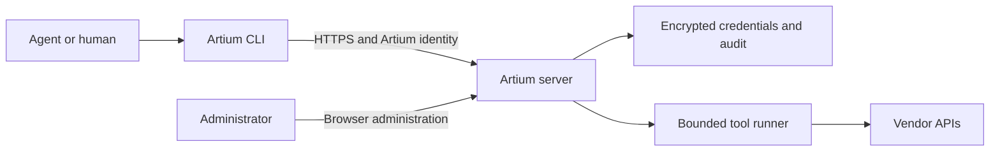

# artium-axi

Managed command-line tools for agents and the humans running them, with one sign-in, role-based access and server-held service credentials.

[](LICENSE)
[](https://www.npmjs.com/package/@knowttl/artium-axi)
[](package.json)
[](https://github.com/knowttl/artium-axi/attestations)

[Quickstart](#quickstart) • [Use with your agent](#use-with-your-agent) • [Features](#features) • [Safety](#safety) • [Configuration](#configuration) • [Commands](#commands)



## Why this exists

Separate vendor CLIs require separate credentials and access controls on every agent host.
Artium runs pinned tools on a shared server, checks each user's roles and supplies the service credential after audited admission.
Agents keep a command-line interface with TOON discovery rather than implementing each vendor's REST authentication or an MCP integration.

## Features

- **Access:** local or browser SSO sign-in, role grants and session revocation.
- **Credentials:** encrypted shared service identities, private per-call profiles and credential tests.
- **Discovery:** available tools, cached health, pinned versions and contextual first-call suggestions.
- **Agent setup:** managed skills for Claude Code, Codex, OpenCode and Pi; optional Claude Code session hook.
- **Audit:** authentication, administration and tool-call records with filtered CSV/JSON-lines export.
- **Limits:** reviewed command inventories, write switches, bounded runtime, output and concurrency.

### Supported pinned tools
| Tool | Managed access |
| --- | --- |
| Falcon | Read-only API client |
| Vectra | Token or OAuth; optional allow-listed writes |
| Azure | Application identity and resource-token broker |
| Microsoft Graph | Application identity; optional allow-listed writes |
| LDAP | Verified TLS simple bind; read-only |
| Azure DevOps | PAT or application identity |
| AWX | Pasted token or one-time password sign-in; optional operational writes |

[Package pins](tools/package.json) and the [Falcon source pin](tools/falcon-source.json) own bundled versions; [reviewed inventories](tools/inventories) define the supported command boundary.

## Quickstart

### Deploy a server with your agent
Give this prompt to the agent helping you administer the server:

> Deploy artium-axi on my Linux host.
> Check Docker/Compose, host capacity, ports, DNS and the HTTPS/TLS plan first.
> Use the repository's Compose file to build the server, or a published image only after verifying its release digest and provenance as described in the runbook.
> Generate an exactly 32-byte random master key into a protected file, make it readable by container UID 10001, and keep an offline escrow copy separate from database backups.
> Create the first administrator through the documented first-start password-file bootstrap, change its temporary password and remove bootstrap inputs.
> Configure tool credentials through the administrator UI, test each credential, enable the intended tools and grant roles.
> Run liveness, readiness and a permitted read for each enabled tool; report results and remaining limits without secrets.
> Never ask me to paste passwords, tokens or keys into chat or command arguments.
> Use hidden prompts, protected stdin or files with safe permissions for secrets.
> Follow docs/admin-guide.md, docs/tool-credentials.md and docs/runbook.md for the exact steps.

For manual deployment, follow the [administrator guide](docs/admin-guide.md#set-up-a-host).

### Verified client
Use Linux with Node **24.11.0+**, curl and sha256sum, and obtain the trusted HTTPS URL and account from your administrator.
For a private CA, set `ARTIUM_AXI_CA_FILE` to a readable PEM file and add `--cacert "$ARTIUM_AXI_CA_FILE"` to both curl commands.

```sh
export ARTIUM_AXI_URL='https://artium.example.test'
mkdir -p "$HOME/.local/bin"
cd "$HOME/.local/bin"
curl --fail --output artium-axi.mjs "$ARTIUM_AXI_URL/cli/artium-axi.mjs" &&
curl --fail --output artium-axi.mjs.sha256 "$ARTIUM_AXI_URL/cli/artium-axi.mjs.sha256" &&
sha256sum --check artium-axi.mjs.sha256 &&
mv artium-axi.mjs artium-axi &&
chmod 755 artium-axi &&
rm artium-axi.mjs.sha256
export PATH="$HOME/.local/bin:$PATH"
```

Stop if a download or checksum fails.
The checksum detects corruption and mixed releases; trust still comes from the HTTPS server.

```sh
artium-axi login --username synthetic-user
artium-axi tools
artium-axi tools show falcon-axi
artium-axi falcon-axi detection list
```

Replace the synthetic username with your account; login uses a hidden terminal password prompt.
For `PASSWORD_CHANGE_REQUIRED`, run `artium-axi passwd`, then log in again.
For SSO, use `artium-axi login --sso` and approve only the browser code matching your own terminal.
After ordinary login, later commands, installed hooks and skills use [saved connection settings](docs/client-reference.md#client-settings).
After a server upgrade, run `artium-axi update`, then `artium-axi --version`.
The updater uses those connection settings, verifies the server download’s SHA-256, replaces the running client file and keeps the previous client beside it as `<client-file>.bak`.
The client file and its directory must be writable.
The Falcon read requires an enabled tool, a role grant and API permissions; choose the example from an available tool's detail view.

With no enabled tools granted, `artium-axi tools` succeeds with:

```text
tools: 0 available
reason: No enabled runtime tool is available through your assigned roles.
contact: Ask an administrator to check your role assignments and enabled tools.
next[1]:
  - artium-axi whoami
```

### npm client alternative
The server download supplies its matching client; npm is an alternative client-only distribution.

```sh
npm install -g @knowttl/artium-axi
export ARTIUM_AXI_URL='https://artium.example.test'
artium-axi login --username synthetic-user
```

Login warns about version differences; minimum server API requirements still apply.
`artium-axi update` refuses npm installations; update them with `npm install -g @knowttl/artium-axi@latest`.
Install `@knowttl/artium-axi@<server-version>` or download from the server to match it.

### Build from source
Use Node 24.11.0+, pnpm 10.22.0, OpenSSL, Python 3, curl and sha256sum on Linux.

```sh
git clone https://github.com/knowttl/artium-axi.git
cd artium-axi
pnpm install --frozen-lockfile
pnpm build
node dist/cli/artium-axi.mjs --help
```

Use `node dist/cli/artium-axi.mjs` in place of `artium-axi` for the same login and discovery steps.
The root install also installs frozen upstream dependencies; native build approval is limited to argon2, better-sqlite3 and esbuild.
`pnpm build:npm` stages the public client in `dist/npm`; `npm pack --dry-run ./dist/npm` inspects its contents.

## Use with your agent

After signing in, install the base skill and your granted tools' adapted skills:

```sh
artium-axi setup --host claude --hook
```

Use `--host codex`, `--host opencode` or `--host pi` without `--hook` for those hosts.
Only Claude Code supports the optional `SessionStart` hook, which injects the `tools` discovery output.
Setup preserves unrelated settings and refuses edited/unmanaged skills unless `--force` is explicit.
Re-run setup after moving the executable or changing grants; skills for removed grants are retained and reported.
See [installation paths and manual removal](docs/client-reference.md#agent-installation) before uninstalling.
Artium's authenticated setup fetches managed skills; a standalone skill installer does not configure this server account.

## Safety

All tools start disabled; write access defaults to off.
Administrator capability alone grants no tool access; upstream permissions remain an additional boundary.

| Tool | Write capability and unlock |
| --- | --- |
| Falcon, LDAP | Fixed read-only; Falcon's NG-SIEM search-job start/stop effects remain available regardless of any legacy saved write setting. LDAP has no writes. |
| Azure | Reviewed resource mutations; administrator `allowWrites: true` plus native command gates. |
| Graph, Vectra | Native mutations only with administrator `writes.allowWrites: true` and an explicit operations allow-list, plus native gates. |
| Azure DevOps | Reviewed mutations with administrator `allowWrites: true`; raw `api` remains GET-only. |
| AWX | Launch/cancel/relaunch, workflow approval/denial, project/inventory-source sync and notification tests with `allowWrites: true` and upstream `--confirm`; configuration, deletion and security writes stay blocked. |

There is no universal Artium confirmation flag.
Use authenticated tool help and the [write-access runbook](docs/runbook.md#roles-credentials-and-health) for operation-specific gates.
After an unknown write outcome, inspect state using returned guidance before retrying.

| Initial read | Required upstream permission |
| --- | --- |
| Falcon detections | `Alerts:read` |
| Vectra credential test | Health reads plus permissions for intended data |
| Azure subscription list | Application access to intended subscriptions; data-plane roles separately |
| Graph first-user read | Application `User.Read.All` with administrator consent |
| LDAP | Bind identity with directory read access |
| Azure DevOps project list | Identity permitted to view the organization/project |
| AWX job list | Token identity with job read access |

See [tool credentials](docs/tool-credentials.md) for dedicated identities, permissions and safe credential entry.
Artium stores shared service credentials encrypted with AES-256-GCM and never returns saved secrets to clients.
The data volume also holds the plaintext master key beside SQLite: protect the entire volume and keep offline escrow separate.
Linux client sessions use a mode-0700 directory and mode-0600 file under `${XDG_CONFIG_HOME:-~/.config}/artium-axi`.
Access tokens last one hour, with 12-hour local or 8-hour SSO CLI families; password changes revoke sessions.

Requests, bounded tool input and uploads travel to the server; enabled tools contact their upstream APIs using shared service identities.
Audit excludes injected credentials, request bodies, stdin, uploads and output streams.
The runner scans known secret encodings and discards output on a match; unknown upstream-minted tokens cannot be identified by exact-value scanning.
Its restricted environment, private directories and process limits are not a complete sandbox; descendants starting a new session can escape process-group termination.

## Configuration

| Setting or flag | Purpose |
| --- | --- |
| `ARTIUM_AXI_URL`, `ARTIUM_AXI_CA_FILE` | Connection overrides; see [client settings](docs/client-reference.md#client-settings) |
| `XDG_CONFIG_HOME` | Linux session-storage base, default `~/.config` |
| `--password-stdin` | Login/new password via protected stdin |
| `--host`, `--hook`, `--force` | Setup host, optional Claude hook, explicit skill replacement |
| `--managed-session` | Caller-owned tokens through private pipes; see client reference |
| `--help`, `--version` | Local discovery without sign-in |

See the [client reference](docs/client-reference.md) for password inputs, refresh behavior, uploads and managed sessions.
Server settings, SSO and browser administration live in the [administrator guide](docs/admin-guide.md).
Recovery, rotation, retention, backups and release gates live in the [operations runbook](docs/runbook.md).

## Commands

This summary follows the [CLI help registry](src/cli/help.ts); `artium-axi --help` prints its complete current command list.

| Command | Purpose |
| --- | --- |
| `artium-axi` | Identity, roles and available tools |
| `login --username <username>` / `login --sso` | Local password / browser approval |
| `passwd` / `logout` | Change password / remove local tokens and attempt revocation |
| `whoami` | Identity, roles, [session and access-token expiry](docs/client-reference.md#toon-output-behavior) and server |
| `tools` / `tools show <tool>` | Granted enabled tools / pinned help and first call |
| `doctor` | Server, TLS, token, version and cached health; five-second request deadlines |
| `update` | Update the [server-downloaded client](#verified-client) |
| `setup --host <host>` | Install managed skills and optional Claude hook |
| `<tool> <args>` | Run any of the seven managed tools above |
| `--managed-session --help` | Private-pipe session protocol |

`artium-axi --help falcon-axi` is local help; `artium-axi falcon-axi --help` authenticates and calls upstream.
The [full client reference](docs/client-reference.md#command-surface-and-subcommands) describes forwarding and supported input.

### TOON output and errors
Discovery and Artium errors use TOON on stdout; progress uses stderr.
Upstream stdout, stderr and exit status pass through, with managed suggestions adapted to Artium commands.
Artium exits 0 for success, 2 for usage/configuration errors and 1 for authentication/server/transport failures.
See the generated [error catalogue](docs/errors.md) for actionable codes and retry guidance.

## Platform limits

Linux client and Linux amd64 container paths have local fake-service acceptance.
Windows/macOS execution, token storage and actual agent-host loading remain unverified.
Local tests do not establish live vendor permissions or production host acceptance.
LDAP uses simple bind over verified TLS; ambient Kerberos, per-user upstream credentials and external secret stores are unsupported.
Azure has reviewed bounded input/upload support; ADO and AWX reject stdin and file uploads.
See [adapter limits](docs/tool-credentials.md) and [deployment requirements](docs/runbook.md#scope-and-prerequisites).

## Contributing

Use Linux and run `pnpm check`; every change uses local no-mistakes validation, with no hosted test CI.
See [CONTRIBUTING.md](CONTRIBUTING.md) for hygiene checks, conditional container acceptance and the mandatory release container gate.

## License

[MIT](LICENSE).

If this project saved you time or helped your workflow, please consider giving it a ⭐ on GitHub to help others find it!
